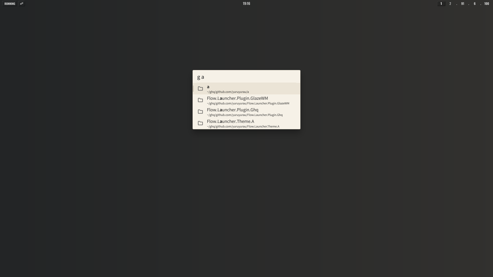
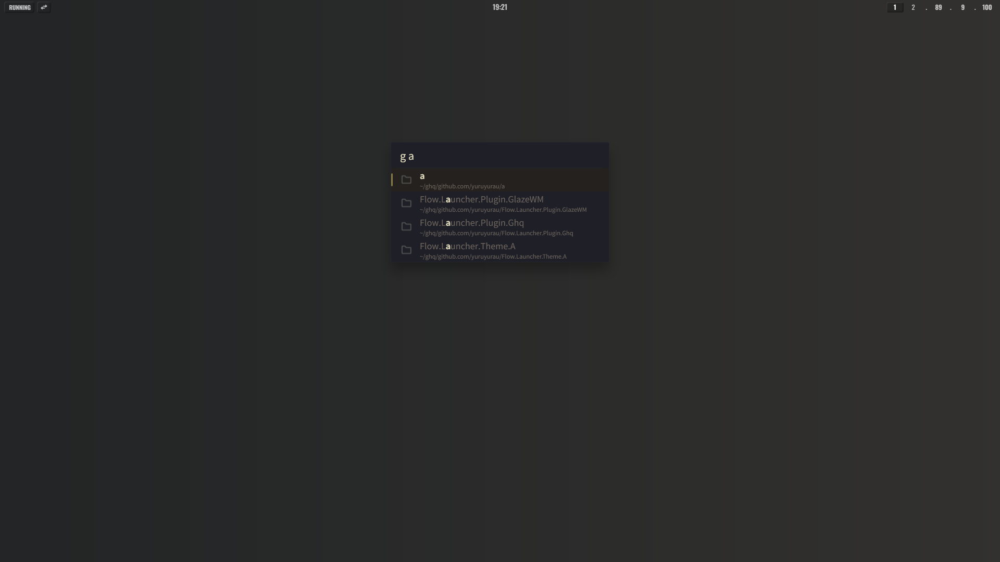

# Flow.Launcher.Plugin.Ghq

A Flow Launcher plugin for searching local
[ghq](https://github.com/x-motemen/ghq) repositories and opening them in File
Explorer.

## Preview

|                  a.                   |                 b.                  |
| :-----------------------------------: | :---------------------------------: |
|  |  |

<sub>Using
[yuruyurau/Flow.Launcher.Theme.A](https://github.com/yuruyurau/Flow.Launcher.Theme.A)
for the preview.</sub>

## Usage

Type `g` followed by a search query: `g <query>`

- Lists all repositories managed by ghq when no query is given
- Filters repositories by partial match (uses `ghq list`)
- Selecting a result opens the directory with the file manager configured in
  Flow Launcher (default: Explorer)

_Note: Path display is shortened for readability (`~` for user profile, `~msys`
for MSYS2 home)._

## Prerequisites

- [ghq](https://github.com/x-motemen/ghq) must be installed and available in
  your `PATH`

## Installation

```text
pm install https://github.com/yuruyurau/Flow.Launcher.Plugin.Ghq/releases/latest/download/Ghq.zip
```

**Or**

1. Download the latest release from
   [Releases](https://github.com/yuruyurau/Flow.Launcher.Plugin.Ghq/releases).
2. Extract the zip to `%APPDATA%/FlowLauncher/Plugins/Ghq/`.
3. Restart Flow Launcher.

## Credits

- [Flow Launcher](https://github.com/Flow-Launcher/Flow.Launcher)
- [ghq](https://github.com/x-motemen/ghq)
- Assisted by [Grok](https://grok.com)
